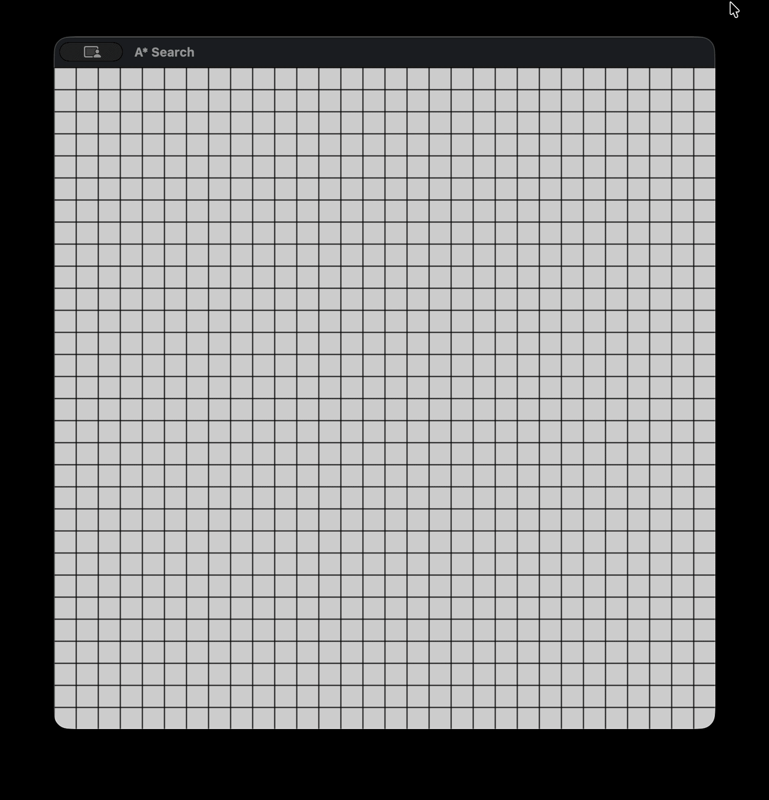

# A* Pathfinding Visualizer

An interactive, step-by-step pathfinding visualizer built completely from scratch using Python and PyGame. This project features a modular multi-class architecture, heap-optimized pathfinding, and procedural maze generation.

[A* Pathfinding Demo](assets/custom_map_demo.gif)

## Project Architecture

The project is organized into clean, decoupled modules to separate game state, visualization, and algorithmic logic:

* **`config.py`**: Centralizes global configuration settings, window dimensions, color themes, and serves as the primary entry point to run the application.
* **`app.py`**: Manages the PyGame main event loop, frame-by-frame rendering, and user input states.
* **`astar.py`**: Houses the core step-by-step A* pathfinding engine, Manhattan distance heuristic, and priority queue handling.
* **`maze_generator.py`**: Implements procedural maze generation algorithms to dynamically populate complex grid layouts.
* **`cell.py`**: Defines the individual grid cell states (start, goal, wall, open, closed, path) and drawing methods.

## Features

* **Heap-Optimized A* Search**: Utilizes Python's `heapq` module with a custom `(f_score, h_score, coordinate)` tuple structure to ensure efficient node traversal and intelligent tie-breaking.
* **Procedural Maze Generation**: Automatically generates intricate mazes using the recursive backtracker algorithm at the press of a key to test pathfinding efficiency under heavy obstacles.



* **Interactive Controls**: Click and drag to draw walls or dynamically reposition the start and goal nodes.
* **Frame-by-Frame Execution**: Designed with an iterative state machine model, allowing the algorithm to animate step-by-step rather than freezing the screen.

## Controls

* **Left Click (1st click)**: Place the **Start** node.
* **Left Click (2nd click)**: Place the **Goal** node.
* **Left Click + Drag**: Paint **Walls** across the grid.
* **Right Click + Drag**: Erase walls or reset node positions.
* **`M` Key**: Generate a procedural maze using the recursive backtracker algorithm.

## How to Run

1. Ensure you have Python installed, then install PyGame:
   ```bash
   pip install pygame
   ```

2. Clone the repository:
   ```bash
   git clone https://github.com/aveyngrey/a-star-search.git
   cd a-star-search
   ```

3. Run the application:
   ```bash
   python config.py
   ```